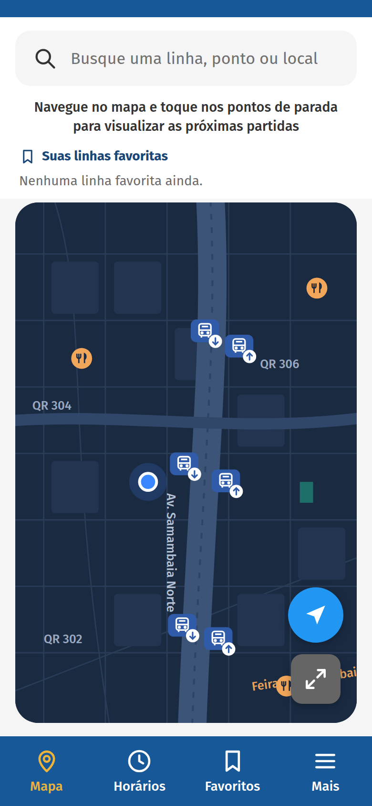
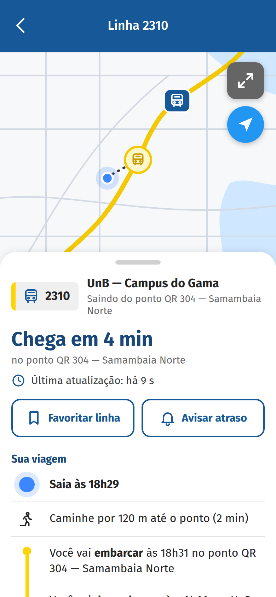
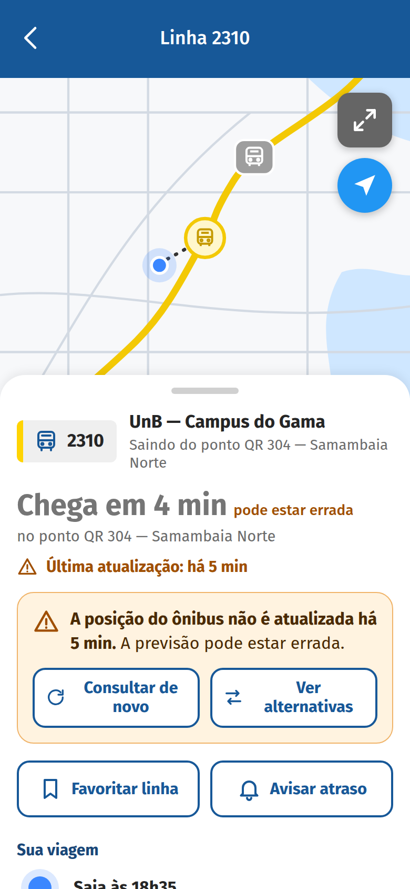

# Protótipo de Alta Fidelidade - TAR-06 (DF no Ponto)

Protótipo navegável usado na **avaliação de alta fidelidade da TAR-06 - Consulta de ônibus em tempo real no DF no Ponto**. Faz parte do projeto do **Grupo 05** da disciplina **Interação Humano-Computador** (FCTE/UnB, semestre 2026/2), que avalia e propõe o reprojeto dos serviços digitais da SEMOB-DF.

| | |
| :--- | :--- |
| **Abrir o protótipo** | https://carloshfgit.github.io/prototipo-tar06-df-no-ponto/ |
| **Site do projeto do grupo** | https://interacao-humano-computador.github.io/2026.2-Grupo05/ |
| **Autor do design** | [Carlos Costa](https://github.com/carloshfgit) |
| **Versão** | 1.0 (10/11/2026) |

> **Aviso:** este é um **protótipo acadêmico**. Ele não é o aplicativo oficial DF no Ponto e não tem ligação com a SEMOB-DF ou com o GDF. As linhas, os pontos, os horários e as posições dos ônibus são **fictícios**, e nenhum serviço real é consultado.

<p align="center">
  
  
  
</p>

---

## Sumário

1. [Contexto](#1-contexto)
2. [O que o protótipo permite fazer](#2-o-que-o-protótipo-permite-fazer)
3. [Telas](#3-telas)
4. [Decisões de design](#4-decisões-de-design)
5. [Como usar](#5-como-usar)
6. [Painel do condutor e registro da sessão](#6-painel-do-condutor-e-registro-da-sessão)
7. [Executar localmente](#7-executar-localmente)
8. [Estrutura do repositório](#8-estrutura-do-repositório)
9. [Detalhes técnicos](#9-detalhes-técnicos)
10. [Limitações](#10-limitações)
11. [Histórico de versão](#11-histórico-de-versão)
12. [Autoria e uso de IA generativa](#12-autoria-e-uso-de-ia-generativa)
13. [Referências](#13-referências)

---

## 1. Contexto

A TAR-06 analisa a tarefa de **descobrir quando o ônibus chega, avaliar se a previsão é confiável e decidir o que fazer**. Ela parte do Cenário 2 do projeto: um estudante, num ponto de Samambaia Norte, precisa chegar à UnB — Campus do Gama para a primeira aula da manhã.

O protótipo é a terceira etapa de uma sequência de avaliações formativas:

| Nível | Artefato | Situação |
| :---: | :--- | :--- |
| 1 | Storyboard 08 | Avaliado |
| 2 | Protótipo de papel (peças T1–T4, N1 e N2) | Avaliado |
| 3 | **Este protótipo de alta fidelidade** | Em avaliação |

O planejamento da avaliação (método, tarefas, perguntas e cuidados éticos) e o relato dos resultados estão no [site do projeto](https://interacao-humano-computador.github.io/2026.2-Grupo05/), no Nível 3 de Design, Avaliação e Desenvolvimento.

O protótipo foi feito em HTML em vez de Figma para ter interações mais próximas das reais:

- a última atualização da posição conta o tempo de verdade;
- o aviso de posição desatualizada aparece em um momento definido;
- a busca responde ao que é digitado;
- favoritos e avisos guardam o estado.

## 2. O que o protótipo permite fazer

- **Buscar** por lugar, ponto de parada ou número da linha, numa barra única com sugestões.
- **Ver as linhas** que levam a um lugar ou que passam num ponto, com a previsão de chegada e onde cada uma desce.
- **Consultar uma linha:**
  - previsão ("Chega em X min");
  - última atualização da posição;
  - mapa com o ônibus andando;
  - resumo da viagem (embarque, desembarque e chegada).
- **Lidar com informação defasada:** quando a posição do ônibus para de ser atualizada, um aviso explica o problema e oferece "Consultar de novo" e "Ver alternativas".
- **Comparar alternativas** para o mesmo destino.
- **Favoritar uma linha** e **pedir aviso de atraso**, com confirmação e estado sempre visível.
- **Desfazer** as ações de favoritar e de desativar o aviso.

## 3. Telas

| ID | Tela | Origem no protótipo de papel | Captura |
| :---: | :--- | :---: | :---: |
| **A1** | Início: busca, linhas favoritas e mapa com os pontos de parada | T1 | [ver](capturas/A1-inicio.png) |
| **A2** | Busca com sugestões de lugares, pontos e linhas | Lista de sugestões | [ver](capturas/A2-sugestoes-unb.png) |
| **E1** | Busca sem resultado, com sugestão de nova busca | — | [ver](capturas/E1-busca-sem-resultado.png) |
| **A3** | Resultados por lugar ou por ponto de parada | T2 | [lugar](capturas/A3-resultados-lugar.png) · [ponto](capturas/A3-resultados-ponto.png) |
| **A4** | Linha: previsão, última atualização, mapa, favoritar, avisar atraso e viagem | T3 | [ver](capturas/A4-linha-2310.png) |
| **N1** | Aviso de posição desatualizada | N1 | [aviso](capturas/N1-aviso.png) · [consultando](capturas/N1-consultando.png) · [atualizado](capturas/N1-consultado.png) |
| **A5** | Alternativas para o mesmo destino | T4 | [ver](capturas/A5-alternativas.png) |
| **N2** | Confirmações de linha favoritada e de aviso de atraso | N2 | [favorito](capturas/N2a-favoritada.png) · [escolha do aviso](capturas/N2b-folha-aviso.png) · [aviso ativo](capturas/N2b-aviso-ativo.png) |
| **A6** | Aba Favoritos | — | [ver](capturas/A6-favoritos.png) |
| **E2** | Partes fora do escopo (abas Horários e Mais, ajuda) | — | [ver](capturas/E2-fora-do-prototipo.png) |

## 4. Decisões de design

### 4.1 Identidade visual do aplicativo real

O protótipo reproduz a aparência do aplicativo DF no Ponto. A ideia é que o participante sinta que está usando o app, só que com as mudanças propostas. As cores foram medidas em capturas de tela do aplicativo:

| Elemento | Cor |
| :--- | :---: |
| Barra superior e barra de abas | `#175898` |
| Aba selecionada | `#ECB43B` |
| Faixa dos "chips" de linha e rota no mapa | `#FFD403` |
| Textos de destaque | `#194778` |
| Fundo | `#F5F5F5` |

Também seguem o app:

- a barra de abas (Mapa, Horários, Favoritos e Mais);
- o campo "Busque uma linha, ponto ou local";
- o mapa escuro da tela inicial e o mapa claro da viagem;
- a linha do tempo da viagem.

A fonte é a Fira Sans.

### 4.2 Guia de Estilo do Grupo 05

O vocabulário e as regras de interação seguem o Guia de Estilo do projeto:

- **Termos controlados:** "Chega em X min" e "Última atualização".
- **Botões com verbo de ação e texto:** "Favoritar linha", "Avisar atraso", "Consultar de novo" e "Ver alternativas". Nenhuma ação depende só de um ícone.
- **Estados visíveis:** "Favoritada" e "Aviso ativo" continuam na tela depois da confirmação.
- **Alertas que não dependem só de cor:** sempre têm ícone e texto.
- **Erros em linguagem simples:** dizem o que fazer, e o texto digitado é mantido.

### 4.3 Correções vindas do protótipo de papel

| Pendência do papel | Como o protótipo responde |
| :--- | :--- |
| O aviso de posição desatualizada oferecia só "Ver alternativas". | O aviso traz **"Consultar de novo"** e **"Ver alternativas"**, com o mesmo peso visual, para não induzir a escolha. |
| A lista de resultados por lugar, com linhas de números parecidos, não chegou a ser testada. | A busca por lugar leva a uma lista com linhas de números parecidos e destinos diferentes. |
| Os tempos das tarefas não foram medidos. | O protótipo registra os toques e as trocas de tela com horário (seção 6). |

## 5. Como usar

### No celular (forma usada nas sessões)

1. Abra o link (https://carloshfgit.github.io/prototipo-tar06-df-no-ponto/) no **Chrome** do celular.
2. No menu do navegador, toque em **"Adicionar à tela inicial"**. O protótipo passa a abrir em tela cheia, sem a barra de endereço, como um aplicativo.
3. Antes de cada participante, abra o painel do condutor e toque em **"Nova sessão"** (seção 6).

### No computador

Abra o link, ou o arquivo `index.html`, no navegador. Em telas grandes o protótipo aparece dentro de uma moldura de celular de 390 × 844 px.

### Sem internet

Salve o `index.html` no aparelho e abra pelo navegador. Tudo funciona; só a fonte Fira Sans é trocada pela fonte do sistema.

## 6. Painel do condutor e registro da sessão

O painel é invisível para o participante. Há duas formas de abrir:

- **segurar por 3 segundos** a faixa azul no topo da tela inicial;
- abrir o endereço com **`#condutor`** no final.

| Função | O que faz |
| :--- | :--- |
| **Nova sessão** | Zera favoritos, avisos, buscas recentes, relógios e registro, e volta à tela inicial. |
| **Mostrar aviso N1 agora** | Faz a posição da linha 2310 ficar desatualizada imediatamente. |
| **Aviso N1 aparece após (s)** | Muda o tempo do aviso automático. O padrão é 20 s depois da primeira abertura da linha 2310. |
| **Exportar registro (.json)** | Baixa o registro da sessão. |
| **Mostrar registro para copiar** | Mostra o registro em texto, separado por tabulação. |

O **registro da sessão** guarda, para cada evento:

- o horário;
- os segundos desde o início da sessão;
- a tela;
- o tipo de evento (troca de tela, toque, toque sem ação, busca);
- o elemento tocado.

Ele serve para conferir os tempos de cada tarefa e os toques em lugares errados. **Nenhum dado pessoal é registrado**, e o registro fica apenas no navegador do aparelho (`localStorage`), até ser exportado ou apagado em "Nova sessão".

## 7. Executar localmente

Não há dependências nem etapa de build.

```bash
git clone https://github.com/carloshfgit/prototipo-tar06-df-no-ponto.git
cd prototipo-tar06-df-no-ponto
python3 -m http.server 8000
# abra http://localhost:8000 no navegador
```

Também é possível abrir o `index.html` direto, com duplo clique. Um servidor local só é necessário para testar o manifesto ("Adicionar à tela inicial").

## 8. Estrutura do repositório

```
.
├── index.html             # protótipo completo (HTML, CSS, JavaScript, ícones e mapas em SVG)
├── manifest.webmanifest   # permite instalar na tela inicial e abrir em tela cheia
├── icone.svg              # ícone do protótipo
├── capturas/              # capturas de todas as telas e estados (390 × 844, 2x)
├── .github/workflows/
│   └── pages.yml          # publicação no GitHub Pages
└── README.md
```

**Publicação.** O GitHub Pages é atualizado pelo workflow `pages.yml` só quando um push na `main` altera `index.html`, `manifest.webmanifest`, `icone.svg` ou o próprio workflow. Só esses três arquivos são publicados. Mudanças no README ou nas capturas não disparam o deploy. Para publicar manualmente, use **Actions → Publicar protótipo no GitHub Pages → Run workflow**.

## 9. Detalhes técnicos

- **Tecnologia:** HTML, CSS e JavaScript puro, num único arquivo e sem bibliotecas. A única dependência externa é a fonte Fira Sans (Google Fonts).
- **Navegação:** cada tela é desenhada por uma função. A troca de telas usa a History API, então o botão voltar do Android e do navegador funciona em todas as telas.
- **Estado:** favoritos, avisos, buscas recentes e registro ficam no `localStorage`. Por isso o protótipo mantém o estado se a página for recarregada no meio da sessão.
- **Tempo real simulado:**
  - as previsões diminuem a cada minuto;
  - quando um ônibus "passa", a previsão salta para o próximo, 15 min depois;
  - a última atualização da posição se renova a cada 15 s, quando o ônibus avança no mapa.
- **Mapas:** desenhados em SVG, sem serviço de mapas nem chave de API.
- **Acessibilidade:**
  - alvos de toque de pelo menos 48 px;
  - rótulos acessíveis nos ícones;
  - foco visível;
  - avisos anunciados por leitores de tela (`role="status"` e `role="alert"`);
  - contraste de texto de pelo menos 4,5:1 nas cores definidas para o protótipo. A exceção é o amarelo da aba selecionada (3,9:1 sobre o azul), mantido para reproduzir o aplicativo real.
- **Testes:** todos os caminhos das tarefas foram percorridos de forma automatizada no Chrome sem interface, em tela de 390 × 844. As capturas em `capturas/` saíram dessa execução.

## 10. Limitações

- Os dados são fictícios e cobrem só a região de Samambaia Norte e o destino UnB — Campus do Gama.
- O aviso de posição desatualizada é um **estado simulado**, que acontece em um momento definido, e não uma falha real do rastreamento.
- O aviso de atraso não envia notificações de verdade; apenas registra a escolha e mostra o estado.
- As abas **Horários** e **Mais**, o botão de ajuda e o planejador de viagem não fazem parte do escopo da TAR-06 e mostram uma tela informando isso.
- O mapa não pode ser arrastado nem ampliado com gestos. O botão de tela cheia só aumenta a área do mapa.

## 11. Histórico de versão

| Data | Versão | Descrição | Autor |
| :---: | :---: | :--- | :--- |
| 10/11/2026 | `1.0` | Primeira versão do protótipo, com as telas A1–A6, N1, N2, E1 e E2, o painel do condutor e o registro da sessão. | [Carlos Costa](https://github.com/carloshfgit) |

Ajustes feitos depois do teste piloto entram como novas versões, e cada versão corresponde a um commit deste repositório. A versão em uso aparece no painel do condutor.

## 12. Autoria e uso de IA generativa

O design do protótipo é de **Carlos Costa**: telas, fluxos, textos, dados fictícios e decisões de interação, com base na TAR-06, no protótipo de papel e no Guia de Estilo do Grupo 05.

O código foi implementado com o **Claude Code (Anthropic)** a partir dessa especificação. O autor revisou, testou no celular e aprovou cada tela, e responde integralmente pelo conteúdo.

O nome e a aparência do aplicativo DF no Ponto são usados apenas como referência visual, para fins acadêmicos de avaliação de usabilidade.

## 13. Referências

- BARBOSA, Simone Diniz Junqueira; SILVA, Bruno Santana da. **Interação Humano-Computador**. Rio de Janeiro: Elsevier/Campus, 2010.
- BARBOSA, Simone Diniz Junqueira *et al*. **Interação Humano-Computador e Experiência do Usuário**. Rio de Janeiro: Autopublicação, 2021. ISBN 978-65-00-19677-1.
- NIELSEN, Jakob. **Usability Engineering**. San Francisco: Morgan Kaufmann, 1994.
- GRUPO 05. **Projeto de IHC 2026/2 — SEMOB-DF**. Disponível em: https://interacao-humano-computador.github.io/2026.2-Grupo05/.
